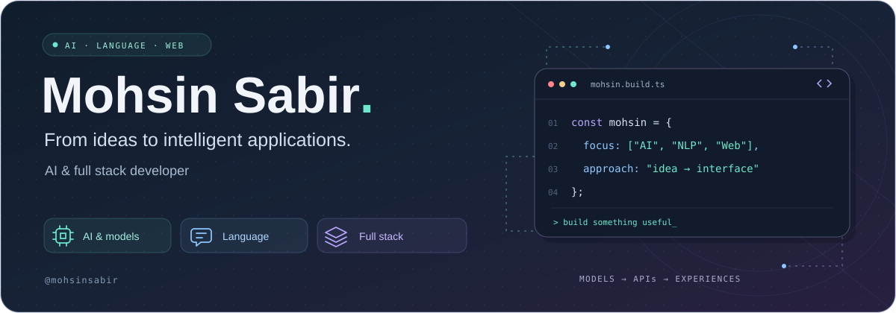

  

  <a href="https://mohsin-sabir-portfolio.vercel.app/">&nbsp; Portfolio</a> &nbsp; / &nbsp;
  <a href="https://www.linkedin.com/in/mohsin-sabir-1a46a82b7">&nbsp; LinkedIn</a> &nbsp; / &nbsp;
  <a href="mailto:sabirmohsin65@gmail.com">&nbsp; Get in touch</a>

### Hey, I'm Mohsin 👋

I build applications with **AI, natural language processing, and full stack development**—from voice agents and image generation to tools that make language more accessible.

I like taking an idea all the way to a usable interface: working with models, connecting APIs, and building the experience around them.

### Selected work

<table>
<tr>
<td width="50%" valign="top">

#### 🎙️ [AI Voice Agent](https://github.com/mohsinsabir/voice-agent)

A dental appointment booking and lead qualification project with a Retell-powered voice agent, API backend, and web call interface.

TypeScript · Node.js · React · Retell AI

</td>
<td width="50%" valign="top">

#### 🎨 [Text to Image](https://github.com/mohsinsabir/TextToImage)

Turn a text prompt into an image with Stable Diffusion and a simple Streamlit interface.

Python · Hugging Face · Diffusers · Streamlit

</td>
</tr>
<tr>
<td width="50%" valign="top">

#### 🌐 [English → Roman Urdu](https://github.com/mohsinsabir/English-into-Roman-urdu)

Translate English into Urdu, then convert the result into readable Roman Urdu in the browser.

Python · MarianMT · Transformers · Streamlit

</td>
<td width="50%" valign="top">

#### 📝 [Text Summarization](https://github.com/mohsinsabir/textsummerization)

An NLP project for turning longer text into shorter summaries.

Python · Natural language processing

</td>
</tr>
</table>

### My toolkit

| Area | Technologies |
| :--- | :--- |
| AI & language | Python, Hugging Face, Transformers, PyTorch, Stable Diffusion |
| Web & APIs | TypeScript, JavaScript, React, Node.js, Streamlit |
| Data & development | PostgreSQL, Supabase, Docker, Git, GitHub Actions |

### What I'm exploring

- Voice agents that connect conversation with useful actions.
- Practical NLP and multilingual language tools.
- Bringing AI models into full stack applications.

---

  <b>Have an interesting idea? Let's build something useful.</b> 
  <a href="mailto:sabirmohsin65@gmail.com">Email me</a> · <a href="https://github.com/mohsinsabir?tab=repositories">Explore my repositories</a>

