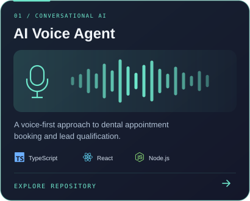
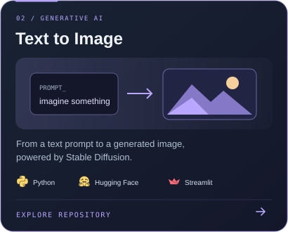
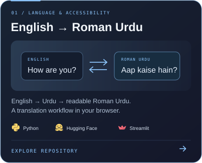
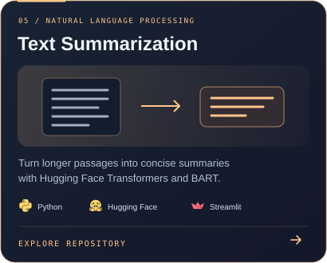
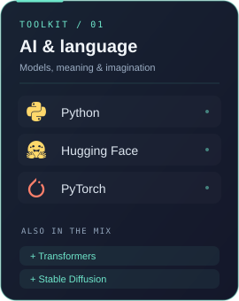
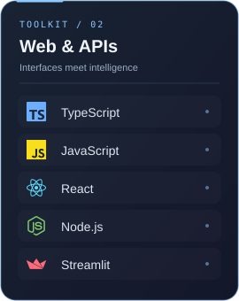
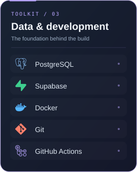
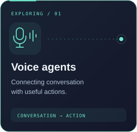
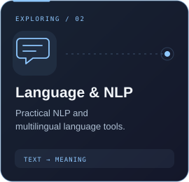
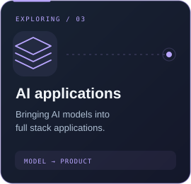

  

   &nbsp;
   &nbsp;
  

### Hey, I'm Mohsin 👋

I build applications with **AI, natural language processing, and full stack development**—from voice agents and image generation to tools that make language more accessible.

I like taking an idea all the way to a usable interface: working with models, connecting APIs, and building the experience around them.

### Selected work

  
  

  
  

### My toolkit

  
  
  

### What I'm exploring

  
  
  

---

  <b>Have an interesting idea? Let's build something useful.</b> 
  <a href="mailto:sabirmohsin65@gmail.com">Email me</a> · <a href="https://github.com/mohsinsabir?tab=repositories">Explore my repositories</a>

